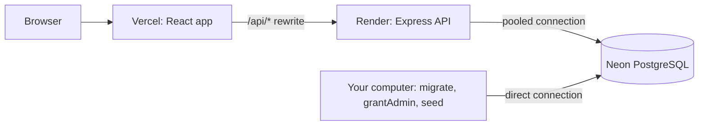

# SupplyFlow Deployment Guide

This guide sets up SupplyFlow from scratch on three free hosting services and keeps it updated.
It assumes no prior experience with any of them.

| Piece                    | Service                                  | Live URL                             |
| ------------------------ | ---------------------------------------- | ------------------------------------ |
| Database (PostgreSQL 16) | [Neon](https://neon.tech)                | (private)                            |
| API (Express)            | [Render](https://render.com) web service | https://supplyflow-pdiw.onrender.com |
| Frontend (React)         | [Vercel](https://vercel.com)             | https://supplyflow-rho.vercel.app    |



> **Never commit secrets.** Connection strings, passwords and `JWT_SECRET` belong only in the
> hosting dashboards and in git-ignored `.env*` files on your computer. Every value in this guide
> written like `<this>` is a placeholder.

## Contents

1. [Before you start](#1-before-you-start)
2. [Create the Neon database](#2-create-the-neon-database)
3. [Run the migrations from your computer](#3-run-the-migrations-from-your-computer)
4. [Deploy the API on Render](#4-deploy-the-api-on-render)
5. [Deploy the frontend on Vercel](#5-deploy-the-frontend-on-vercel)
6. [Create the two administrators](#6-create-the-two-administrators)
7. [Load the demo data (optional)](#7-load-the-demo-data-optional)
8. [Smoke test](#8-smoke-test)
9. [Updating the live site after merges](#9-updating-the-live-site-after-merges)
10. [Troubleshooting](#10-troubleshooting)

## 1. Before you start

You need:

- Accounts on GitHub (with access to the repository), Neon, Render and Vercel.
- **Node.js 20.6 or newer.** The commands below use `node --env-file`. Check with `node -v`.
- **pnpm 12.18.0:** `npm install -g pnpm@12.18.0`.
- **Vercel CLI:** `npm install -g vercel`.
- A local copy of the repository with dependencies installed:

  ```bash
  git clone <repository-url> SupplyFlow
  cd SupplyFlow
  pnpm install
  ```

> On Windows, run the commands in Git Bash. In PowerShell, use `curl.exe` instead of `curl`.

## 2. Create the Neon database

1. In the Neon console, click **New project**. Pick **PostgreSQL 16** (the version CI tests
   against) and a region close to your Render region.
2. Open the project's **Connect** dialog. Neon offers two kinds of connection string for the same
   database:

   | Kind       | How to recognise it                                                     | Use it for                                                    |
   | ---------- | ----------------------------------------------------------------------- | ------------------------------------------------------------- |
   | **Pooled** | Host contains `-pooler`, e.g. `ep-<name>-pooler.<region>.aws.neon.tech` | The running API on Render (`DATABASE_URL` there)              |
   | **Direct** | Same host **without** `-pooler`                                         | Migrations, `grantAdmin` and the seed, run from your computer |

   Both look like
   `postgresql://<user>:<password>@<host>/<database>?sslmode=require`.

**Why two?** The pooled connection goes through PgBouncer, which shares a few database
connections among many clients. That suits a web server. The migration script relies on
_session_ settings: it stores `ADMIN_EMAIL_1/2` with `set_config`, and migration 004 reads them
back. Through a pooler, those settings can be lost between statements. One-off scripts should
therefore always use the **direct** string.

Copy both strings somewhere safe, such as a password manager. Don't paste them into any file
that git tracks.

## 3. Run the migrations from your computer

The live database is set up from your computer, using a git-ignored env file.

1. Create `backend/.env.migrate`:

   ```dotenv
   # backend/.env.migrate: production scripts only. Git-ignored; never commit.
   DATABASE_URL=<Neon DIRECT connection string>
   ADMIN_EMAIL_1=<first administrator's email>
   ADMIN_EMAIL_2=<second administrator's email>
   # Only needed for the optional seed (step 7):
   SEED_EMPLOYEE_PASSWORD=<password for employee@supplyflow.com>
   ```

2. Confirm git ignores it. This command should print a `.gitignore` rule:

   ```bash
   git check-ignore -v backend/.env.migrate
   ```

3. Run the migrations:

   ```bash
   cd backend
   node --env-file=.env.migrate db/migrate.js
   ```

On a **new** database you will see `applied 001_create_orders.sql` through
`applied 003_order_owner.sql`. The run then **fails at `004_fixed_admins.sql`** with
`Both designated administrator accounts must already exist`.

**That is expected.** The tables now exist. Migration 004 can only run after the two
administrators have registered, which happens in [step 6](#6-create-the-two-administrators).
All migrations are safe to run again.

## 4. Deploy the API on Render

The repository's `render.yaml` describes the service. You can create it from the blueprint or
by hand. Either way, **don't create a Render database**: the data lives on Neon.

**Option A: Blueprint.** In Render, choose **New → Blueprint**, connect the GitHub repository and
select the `master` branch. Render reads `render.yaml`, creates the `supplyflow-api` service,
generates `JWT_SECRET`, and asks you for `DATABASE_URL`. Paste the **pooled** Neon string.

**Option B: By hand.** Choose **New → Web Service**, connect the repository, and use:

| Setting           | Value                                                                                    |
| ----------------- | ---------------------------------------------------------------------------------------- |
| Branch            | `master`                                                                                 |
| Root Directory    | _(leave empty: the repository root)_                                                     |
| Runtime           | Node                                                                                     |
| Build Command     | `npx --yes pnpm@12.18.0 install --frozen-lockfile --prod --filter supplyflow-backend...` |
| Start Command     | `node backend/server.js`                                                                 |
| Health Check Path | `/api/health`                                                                            |
| Instance type     | Free                                                                                     |

The service builds from the repository root because the backend imports the `shared/` workspace
package.

**Environment variables** (Service → **Environment**):

| Key            | Value                                                                               |
| -------------- | ----------------------------------------------------------------------------------- |
| `NODE_ENV`     | `production`                                                                        |
| `NODE_VERSION` | `20`                                                                                |
| `DATABASE_URL` | Neon **pooled** connection string                                                   |
| `JWT_SECRET`   | A long random value, e.g. from `openssl rand -hex 32` (the blueprint generates one) |

Leave these out:

- `PORT`: Render sets it automatically.
- `ADMIN_EMAIL_1/2` and `SEED_EMPLOYEE_PASSWORD`: only the scripts on your computer use them.

When the deploy finishes, the logs show `Connected to PostgreSQL database` and
`SupplyFlow API listening on port …`. Check https://supplyflow-pdiw.onrender.com/api/health, or
your own service URL. It should return `{"status":"ok"}`.

With `NODE_ENV=production`, the API **refuses to start** if `DATABASE_URL` or `JWT_SECRET` is
missing or the database is unreachable. A failed deploy usually points to one of those (see
[Troubleshooting](#10-troubleshooting)).

## 5. Deploy the frontend on Vercel

The browser only ever talks to Vercel. `frontend/vercel.json` forwards API calls to Render:

```json
{ "source": "/api/(.*)", "destination": "https://supplyflow-pdiw.onrender.com/api/$1" }
```

**If your Render URL differs, edit that `destination` first and commit the change.**

The frontend reads no environment variables, so Vercel needs none.

### Project settings (Vercel dashboard → Project → Settings)

| Setting                                  | Value                               |
| ---------------------------------------- | ----------------------------------- |
| Framework Preset                         | Vite                                |
| Root Directory                           | `frontend`                          |
| Include files outside the Root Directory | Enabled (the app imports `shared/`) |
| Build Command / Output Directory         | Defaults (`vite build` → `dist`)    |
| Node.js Version                          | 20.x                                |

### Deploy with the Vercel CLI

Run these commands from the **repository root**, not `frontend/`. The root `.vercelignore`
there keeps `.env` files and `node_modules` out of the upload.

```bash
vercel login
vercel link        # once: choose your team and the existing "supplyflow" project
vercel --prod      # build on Vercel and publish to the production URL
```

- `vercel link` creates a `.vercel/` folder that records the linked project. It is git-ignored.
- `vercel` without `--prod` creates a preview deployment, which is useful for testing first.
- `.vercelignore` excludes `**/.env`, `**/.env.*` and `node_modules`. Keep it that way, so your
  local secrets, including `backend/.env.migrate`, are never uploaded.

Then open https://supplyflow-rho.vercel.app. The login page should load.

## 6. Create the two administrators

SupplyFlow allows exactly two administrator accounts. The database pins them to two existing
accounts (migration 004) and then refuses to make anyone else an admin.

1. **Register both accounts** on the live site at `/register`. You can also use
   `POST /api/auth/register` in Swagger UI at `/api/docs`. Use exactly the emails from
   `ADMIN_EMAIL_1` and `ADMIN_EMAIL_2` in `backend/.env.migrate`. They start as employees.
2. **Run the migrations again.** Migration 004 now finds both accounts and locks them in:

   ```bash
   cd backend
   node --env-file=.env.migrate db/migrate.js
   ```

   This time every file through `applied 004_fixed_admins.sql` succeeds.

3. **Grant admin access** to each account:

   ```bash
   node --env-file=.env.migrate db/grantAdmin.js <first administrator's email>
   node --env-file=.env.migrate db/grantAdmin.js <second administrator's email>
   ```

   Each prints `Administrator access granted to <name> (<email>).`

4. Each administrator logs out and back in to see the admin controls: the Users page, vendor
   editing and order approval.

`grantAdmin.js` only works for the two designated accounts. For any other email it prints
`Account not found or not one of the two designated administrators.`

Share the administrator and demo passwords privately, never in the repository.

## 7. Load the demo data (optional)

The seed adds the demo employee `employee@supplyflow.com`, whose password is
`SEED_EMPLOYEE_PASSWORD`. It also adds 140 vendors and 140 orders from `data/`. It never creates
an admin.

```bash
cd backend
node --env-file=.env.migrate db/seed.js
```

The seed is safe to re-run: vendors and orders that already exist are skipped. Each run resets
the demo employee's password to the current `SEED_EMPLOYEE_PASSWORD`.

## 8. Smoke test

After every deploy, run these checks against your own URLs:

```bash
# 1. API is up (may take up to a minute if Render was asleep)
curl https://supplyflow-pdiw.onrender.com/api/health
#    → {"status":"ok"}

# 2. Vercel forwards /api to Render
curl https://supplyflow-rho.vercel.app/api/health
#    → {"status":"ok"}

# 3. Protected routes require login
curl -s -o /dev/null -w "%{http_code}\n" https://supplyflow-rho.vercel.app/api/orders
#    → 401

# 4. Login rejects bad credentials (uses a fake account, no real password)
curl -s -X POST https://supplyflow-rho.vercel.app/api/auth/login \
  -H "Content-Type: application/json" \
  -d '{"email":"nobody@example.com","password":"not-a-real-password"}'
#    → {"error":{"message":"Invalid email or password"}}
```

Then check in the browser:

1. https://supplyflow-pdiw.onrender.com/api/docs shows Swagger UI listing every endpoint.
2. Log in as an **employee**. The dashboard shows numbers. Create a Draft order for an active
   vendor and submit it (status **Pending**). The employee has no Approve option and no Users
   link.
3. Log in as an **administrator**. Approve that order, then mark it **Shipped** and
   **Delivered**. Add or edit a vendor. Open **Users**.
4. Reopen the dashboard. The order counts reflect the changes.

## 9. Updating the live site after merges

When a pull request is merged into `master`, update the live site in this order:

1. **Wait for CI to pass on `master`** (GitHub → Actions).
2. **New migration files?** If the merge added a file to `backend/db/migrations/`, apply it to
   Neon _before_ the new API code goes live:

   ```bash
   git checkout master && git pull
   cd backend
   node --env-file=.env.migrate db/migrate.js
   ```

   Re-running the migrations is safe: files that were already applied make no changes.

3. **API (Render):** if Auto-Deploy is on (the default), Render redeploys from `master` by
   itself. Otherwise open the service and click **Manual Deploy → Deploy latest commit**. Watch
   the logs until the health check passes.
4. **Frontend (Vercel):** from an up-to-date `master` at the repository root:

   ```bash
   vercel --prod
   ```

   If the Vercel project is connected to the GitHub repository, it also deploys automatically on
   every push to `master`.

5. Run the [smoke test](#8-smoke-test).

## 10. Troubleshooting

### The first request is very slow, or the app shows a load error

Free Render services **sleep after about 15 minutes without traffic**, and waking up takes up to
a minute. During that time, requests through Vercel can time out. To wake the service, open
https://supplyflow-pdiw.onrender.com/api/health and wait for `{"status":"ok"}`, then reload the
app. Neon's free tier also pauses idle databases, which adds a second or two to the first query.

### Render deploy fails or the health check never passes

Read the Render logs. The startup errors mean:

- `DATABASE_URL is required in production` or `JWT_SECRET is required in production`: the
  variable is missing in Render → Environment.
- `Cannot connect to PostgreSQL: …`: the connection string is wrong or incomplete. Use the
  **pooled** string, including `?sslmode=require`.

### `Error: listen EADDRINUSE: address already in use :::4000` (local)

Another process, usually an earlier API that is still running, holds port 4000. Stop it:

```bash
# Windows (PowerShell or cmd)
netstat -ano | findstr :4000
taskkill /PID <pid> /F

# macOS / Linux
lsof -i :4000
kill <pid>
```

You can also run the API on another port: set `PORT=4001` in `backend/.env`, then start the
frontend with `VITE_API_PROXY=http://localhost:4001 pnpm dev:web`.

### Logins fail locally even though the account exists (in-memory mode)

If the API log shows `DATABASE_URL not set. Using in-memory data.` or
`PostgreSQL unavailable (…). Using in-memory data.`, the API is **not** using your database. It
starts with no user accounts and forgets everything on restart, so existing logins fail with
"Invalid email or password". Common causes:

- The API was started without loading `backend/.env`, e.g. with `node server.js`. Start it with
  `pnpm dev:api`, which runs `node --env-file=.env`.
- `DATABASE_URL` is empty or wrong in `backend/.env`.
- The local PostgreSQL (or Docker container) isn't running. Start it, then restart the API.

Look for `Connected to PostgreSQL database` in the log.

### The live app loads, but every API call fails (the `vercel.json` placeholder)

Check `frontend/vercel.json`. If the `/api/(.*)` rewrite still says `RENDER_URL_PLACEHOLDER`, or
points to an old Render URL, API calls never reach the API. The usual symptom is that
`https://<your-vercel-app>/api/health` returns a 404 or an error page instead of
`{"status":"ok"}`. Set `destination` to `https://<your-render-service>.onrender.com/api/$1`,
commit, and redeploy with `vercel --prod`.

### `Configure two distinct verified administrator emails before applying this migration`

Migration 004 didn't receive two different admin emails. Check that:

- `ADMIN_EMAIL_1` and `ADMIN_EMAIL_2` are both set and different in the env file you used.
- You ran the migration **with** that file:
  `node --env-file=.env.migrate db/migrate.js` from `backend/`. Plain
  `pnpm --filter supplyflow-backend migrate` loads no env file at all.

Related messages:

- `Both designated administrator accounts must already exist`: register both accounts first
  ([step 6](#6-create-the-two-administrators)). Emails are compared case-insensitively.
- `Administrator identities cannot be changed`: by design. Once migration 004 has run, the two
  administrators are fixed.
