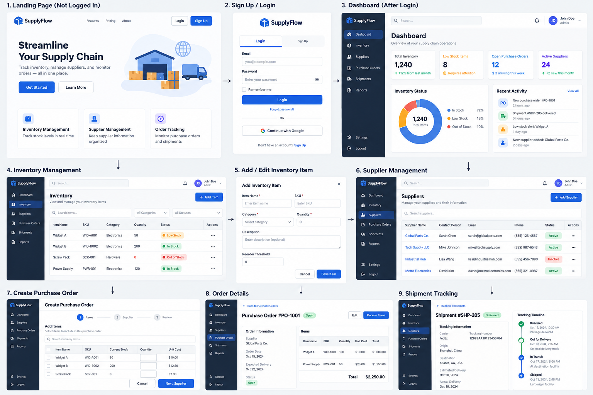

# SupplyFlow — Product Requirements Document

## 1. Project Overview
SupplyFlow is a full-stack supply chain management application for small businesses to manage inventory, suppliers, and purchase orders.

## 2. Problem Statement
Small businesses often rely on disconnected spreadsheets and manual processes, making it difficult to track inventory, suppliers, and purchase orders.

## 3. Target Users
- Inventory managers
- Purchasing staff
- Small business owners

## 4. Core Features

### Authentication
- User registration, login, and logout
- Protected application pages

### Dashboard
- Total inventory and low-stock alerts
- Active supplier count
- Pending purchase orders
- Recent activity

### Inventory Management
- Add, view, edit, and delete products
- Search and filter inventory
- Track quantity, SKU, category, price, and reorder threshold

### Supplier Management
- Add, view, and edit suppliers
- Change supplier status between Active and Inactive
- Prevent inactive suppliers from being selected for new orders

### Purchase Order Management
- Create purchase orders with suppliers and products
- Calculate order totals
- Update order statuses: Pending, Approved, Shipped, Delivered, Cancelled
- Record order status history

### Verification and Confirmation
- Display confirmation dialogs for important changes
- Confirm supplier status changes
- Confirm order approval, cancellation, shipping, and delivery
- Confirm record deletion
- Validate changes on the backend
- Log status changes with timestamps

## 5. Functional Requirements
- FR-01: Users can register and log in.
- FR-02: Users can manage inventory.
- FR-03: Users can manage suppliers and their statuses.
- FR-04: Users can create and update purchase orders.
- FR-05: The system validates order status transitions.
- FR-06: Important actions require user confirmation.
- FR-07: Dashboard statistics reflect saved data.
- FR-08: Changes persist after refreshing the page.

## 6. UI/UX Mockups

### Main Screens
1. Login / Registration
2. Dashboard
3. Inventory Management
4. Add / Edit Inventory
5. Supplier Management
6. Create Purchase Order
7. Purchase Order Details
8. Shipment Tracking (Stretch Goal)

### Design Requirements
- Blue-and-white dashboard interface
- Consistent sidebar navigation
- Searchable tables and reusable forms
- Clear status indicators
- Confirmation dialogs for important changes

## 7. User Flows

### Inventory
Login → Inventory → Add Item → Enter Details → Save

### Supplier Status
Suppliers → Select Supplier → Change Status → Confirm → Save

### Purchase Order
Purchase Orders → Create Order → Select Supplier → Add Items → Submit

### Order Status Verification
Order Details → Change Status → Confirmation Dialog → Confirm → Save

## 8. Security and Accessibility
- Hash passwords securely.
- Validate inputs on the server.
- Protect authenticated endpoints.
- Do not expose credentials in source code.
- Support keyboard navigation and accessible form labels.

## 9. MVP Acceptance Criteria
- Users can authenticate.
- Users can manage inventory and suppliers.
- Users can change supplier statuses.
- Users can create and update purchase orders.
- Important changes require confirmation.
- Status changes are saved and reflected in the UI.

## 10. Stretch Goals
- Shipment tracking
- Advanced reporting
- Role-based access control
- AI demand forecasting

## 11. Development Workflow
The team will use GitHub Issues, feature branches, pull requests, and code reviews. AGENTS.md will define development and testing instructions.
